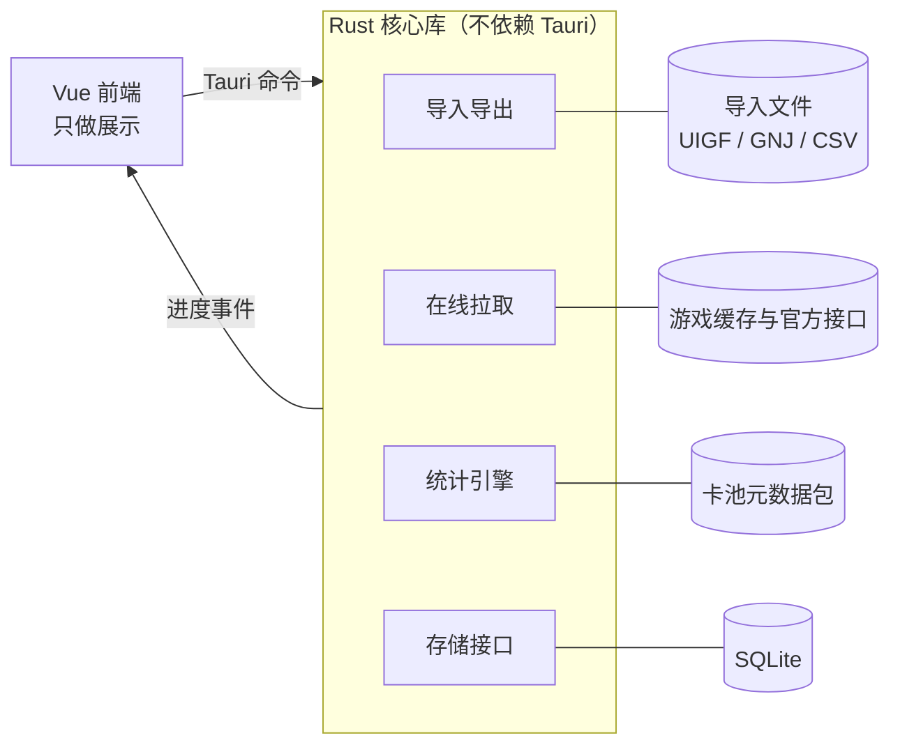

# GachaNote 软件需求规格说明书（SRS）

2026-10-24 · Can

## 1. 引言

本文档把《GachaNote 功能需求文档》里的 24 项功能细化为可验收的软件需求，供开发、测试和后续 UI/UX 设计使用。范围覆盖 v0.1–v0.3 的 Windows 桌面端；手机端和服务器同步只写预留要求。

**需求等级**：「必须」= 不满足则不能发版；「应当」= 默认实现，有充分理由可推迟；「可以」= 可选。

**术语**

| 术语 | 含义 |
| --- | --- |
| 金 | 最高稀有度物品：原神 / 崩铁 5 星、绝区零 S 级、鹰角两款 6 星、鸣潮 5 星 |
| UP | 当期卡池概率提升的限定物品 |
| 歪 | 在限定池出金但不是 UP |
| 小保底 / 大保底 | 上一个金是 UP 时处于小保底；上一个金歪了时处于大保底，下一个金必为 UP |
| 硬保底 | 必定出金的抽数上限 |
| 软保底 | 单抽概率开始递增的抽数 |
| 保底共享组 | 共享同一个保底计数的若干卡池类型 |
| 规则模板 | 描述一款游戏卡池类型与概率规则的配置文件 |
| 卡池元数据包 | 卡池名、起止时间、UP 名单、常驻名单的在线数据文件 |
| UIGF | 米哈游游戏的通用抽卡记录交换格式，v4 起一个文件可含三款游戏 |
| GNJ | 本软件为鹰角两款与鸣潮定义的自定义 JSON 格式（GachaNote JSON），见第 4 节 |

**参考文档**：《GachaNote 功能需求文档》；[UIGF 标准](https://uigf.org/)；参考项目 [HoYo.Gacha](https://github.com/lgou2w/HoYo.Gacha)、[genshin-wish-export](https://github.com/biuuu/genshin-wish-export)、[arknights-gacha-export](https://github.com/AceDroidX/arknights-gacha-export)。

## 2. 总体描述

GachaNote 是单机桌面应用：Vue 前端只做展示，所有数据获取、解析、统计都在 Rust 核心库中完成，经 Tauri 命令暴露给前端。核心库不依赖 Tauri，以便以后被手机端和服务器复用。

图 2-1 系统架构：



核心库的四个模块各自只接一个外部来源；换成手机端或服务器时，只替换前端和存储接口的实现。

### 2.1 运行环境

| 项目 | 要求 |
| --- | --- |
| 操作系统 | Windows 10 1809 及以上、Windows 11，x64 |
| 运行时 | WebView2 Runtime（缺失时安装包引导安装） |
| 网络 | 拉取记录与更新数据包时需要；离线时可浏览与统计已有数据 |
| 屏幕 | 最小窗口 1024 × 640 |

### 2.2 设计约束

- 技术栈固定为 Rust + Tauri 2 + Vue 3，本地数据库用 SQLite。
- 存储层通过 Rust trait 抽象（如 `RecordRepository`），业务代码不直接写 SQL，便于以后换成服务器实现。
- 每款游戏是一个插件式模块：规则模板 + 数据获取器 + 格式转换器。新增游戏不改统计引擎。
- 有成熟格式就直接用（米哈游用 UIGF v4），没有的用 GNJ。
- 不提供单条记录的新增或修改，导入是写入记录的唯一途径。
- 不修改游戏客户端、不读内存、不注入，只读游戏写在磁盘上的日志与缓存文件。

### 2.3 假设与依赖

- 各游戏的抽卡记录接口均为非公开接口，可能无通知变动；文件导入始终可用作兜底。
- 卡池元数据包由开发者在本仓库维护，每期新卡池上线后更新。
- 仓库公开，数据包可经 raw.githubusercontent.com 或 jsDelivr 匿名下载。

## 3. 功能需求

共 10 组、编号 FR-模块-序号，每条附验收标准。版本列沿用功能需求文档。

### 3.1 账号管理（ACC）

| 编号 | 需求 | 等级 | 验收标准 | 版本 |
| --- | --- | --- | --- | --- |
| FR-ACC-01 | 新增账号：选择游戏、输入 UID、可填备注名 | 必须 | UID 不符合该游戏格式时拒绝并提示；同一游戏重复 UID 拒绝 | v0.1 |
| FR-ACC-02 | 导入或拉取到未知 UID 时自动创建账号 | 必须 | 导入报告中列出新建的账号 | v0.1 |
| FR-ACC-03 | 切换当前账号，重启后保持 | 必须 | 重启后打开的仍是上次的账号 | v0.1 |
| FR-ACC-04 | 删除账号及其全部记录 | 必须 | 需二次确认，并提供「先导出」按钮 | v0.1 |

### 3.2 文件导入（IMP）

| 编号 | 需求 | 等级 | 验收标准 | 版本 |
| --- | --- | --- | --- | --- |
| FR-IMP-01 | 导入 UIGF v4.x，兼容 v2.x / v3.x 与 SRGF v1 | 必须 | 一个 v4 文件含多游戏、多 UID 时全部导入；格式校验失败时不写入任何数据 | v0.1 |
| FR-IMP-02 | 导入 GNJ | 必须 | 本软件导出的 GNJ 再导入后记录完全一致 | v0.1 |
| FR-IMP-03 | 导入 arknights-gacha-export 的 CSV（明日方舟、终末地） | 必须 | 按列名映射字段；终末地的 rawJson 列完整保留 | v0.1 |
| FR-IMP-04 | 导入本软件导出的 CSV | 应当 | 导出再导入后记录数一致 | v0.1 |
| FR-IMP-05 | 去重：有官方记录 ID 时按 ID；无 ID 时按「账号 + 卡池类型 + 时间 + 物品 + 同秒序号」 | 必须 | 同一文件重复导入两次，第二次新增 0 条；十连中同名物品不被误合并 | v0.1 |
| FR-IMP-06 | 导入为单个事务，写入前自动备份数据库 | 必须 | 导入中途失败时数据库保持导入前状态；保留最近 5 份备份 | v0.1 |
| FR-IMP-07 | 导入报告：新增、重复、失败条数及失败原因 | 必须 | 失败条目可查看行号和原因 | v0.1 |

### 3.3 在线拉取（FET）

| 编号 | 需求 | 等级 | 验收标准 | 版本 |
| --- | --- | --- | --- | --- |
| FR-FET-01 | 米哈游三款：自动定位游戏目录，从游戏内网页的磁盘缓存中提取最新的抽卡链接 | 必须 | 用户在游戏中打开过抽卡历史后，点一次即可拿到链接；找不到目录时可手动选择 | v0.1 |
| FR-FET-02 | 鸣潮：从 Client.log 中提取抽卡链接 | 必须 | 支持官方启动器、Steam、Epic 三种安装位置 | v0.1 |
| FR-FET-03 | 支持手动粘贴抽卡链接 | 必须 | 粘贴后自动识别游戏与服务器 | v0.1 |
| FR-FET-04 | 增量拉取：逐卡池类型分页请求，遇到已有记录即停止；可选全量拉取 | 必须 | 已有 1 万条记录时，增量拉取只请求新增部分 | v0.1 |
| FR-FET-05 | 请求限速与重试：相邻请求间隔 ≥ 300 ms，网络错误重试 3 次 | 必须 | 触发频率限制时自动放慢而不是失败 | v0.1 |
| FR-FET-06 | 链接过期时明确提示「请在游戏中重新打开抽卡历史」 | 必须 | 不显示原始错误码 | v0.1 |
| FR-FET-07 | 拉取进度（当前卡池、已获条数）与取消 | 必须 | 取消时已拉取部分不写入 | v0.1 |
| FR-FET-08 | 鹰角两款：用户在应用弹出的鹰角官网登录窗口中登录，应用自动获取账号 token（也可手动粘贴 token），换取角色凭证后拉取记录 | 应当 | 一个 token 可同时拉取明日方舟与终末地；终末地武器池逐池拉取 | v0.2 |
| FR-FET-09 | token 用 Windows DPAPI 加密保存在本机，可一键清除 | 必须 | 数据库与日志中不出现明文 token | v0.2 |

### 3.4 导出（EXP）

| 编号 | 需求 | 等级 | 验收标准 | 版本 |
| --- | --- | --- | --- | --- |
| FR-EXP-01 | 米哈游导出 UIGF v4.2，其余导出 GNJ，全部可导出 CSV | 必须 | 导出的 UIGF 能被 HoYo.Gacha 正常导入 | v0.1 |
| FR-EXP-02 | 范围可选：单账号、单游戏、全部 | 必须 | 「全部」生成一个 UIGF 和一个 GNJ 文件 | v0.1 |

### 3.5 卡池元数据（META）

| 编号 | 需求 | 等级 | 验收标准 | 版本 |
| --- | --- | --- | --- | --- |
| FR-META-01 | 启动时读取远程 manifest，版本更新时下载数据包并校验哈希 | 必须 | 哈希不符时丢弃并继续使用旧包 | v0.1 |
| FR-META-02 | 下载顺序：raw.githubusercontent.com → jsDelivr → 安装包内置版本 | 必须 | 断网时仍能用内置数据包完成统计 | v0.1 |
| FR-META-03 | 设置页显示数据包版本与更新时间，可手动检查 | 应当 | — | v0.1 |
| FR-META-04 | 记录找不到对应卡池时，该金标为「UP 未知」，不计入歪率并提示更新数据包 | 必须 | 统计页显示未知条数 | v0.1 |

### 3.6 核心统计（STAT）

口径与公式见功能需求文档第 4 节，参数见本文第 5 节。

| 编号 | 需求 | 等级 | 验收标准 | 版本 |
| --- | --- | --- | --- | --- |
| FR-STAT-01 | 按保底共享组计算当前保底计数、距硬保底剩余抽数、是否大保底 | 必须 | 与游戏内实际状态一致（用测试数据集验证） | v0.1 |
| FR-STAT-02 | 平均出 UP 抽数 | 必须 | 尾部未出 UP 的抽数不计入 | v0.1 |
| FR-STAT-03 | 小保底歪率，同时显示分子与分母 | 必须 | 大保底必出的 UP 不计入分母 | v0.1 |
| FR-STAT-04 | 基础统计：总抽数、各星级数量与占比、平均出金抽数 | 必须 | — | v0.1 |
| FR-STAT-05 | 非抽卡条目（如终末地的赠送条目）保存但不计入抽数 | 必须 | — | v0.1 |
| FR-STAT-06 | 导入或拉取完成后自动重算 | 必须 | 见第 7 节性能要求 | v0.1 |

### 3.7 记录浏览（REC）

| 编号 | 需求 | 等级 | 验收标准 | 版本 |
| --- | --- | --- | --- | --- |
| FR-REC-01 | 按卡池类型、星级、时间范围筛选，按名称搜索 | 必须 | 筛选条件可组合 | v0.1 |
| FR-REC-02 | 金显示当次花费抽数及 UP / 歪标记 | 必须 | — | v0.1 |
| FR-REC-03 | 分页显示（每页 20 / 50 / 100 条） | 必须 | 5 万条记录翻页响应 < 200 ms | v0.1 |

### 3.8 总览与图表分析（OVW / ANA）

| 编号 | 需求 | 等级 | 验收标准 | 版本 |
| --- | --- | --- | --- | --- |
| FR-OVW-01 | 首页以卡片显示所有账号：游戏、备注名、各限定池当前保底、总抽数、最后更新时间 | 必须 | 点击卡片进入该账号详情 | v0.1 |
| FR-ANA-01 | 出金抽数分布图，按时间顺序、区分 UP / 歪 | 应当 | 悬停显示物品名、日期、抽数 | v0.2 |
| FR-ANA-02 | 按月抽卡趋势：每月抽数与出金数 | 应当 | — | v0.2 |
| FR-ANA-03 | 出金概率预测：下一抽及未来 10 / 50 / 至硬保底抽内出金与出 UP 的概率 | 应当 | 与蒙特卡洛模拟 100 万次的结果误差 < 0.5 个百分点 | v0.2 |
| FR-ANA-04 | 欧非评价：给出百分位与评级，样本 < 5 个金时不评级 | 应当 | — | v0.2 |
| FR-ANA-05 | 卡池历史时间线；缺元数据时按卡池类型与时间自动分段 | 可以 | — | v0.3 |
| FR-ANA-06 | 分享图：导出 PNG，默认遮挡 UID 中间位 | 可以 | — | v0.3 |

### 3.9 设置（SET）

| 编号 | 需求 | 等级 | 验收标准 | 版本 |
| --- | --- | --- | --- | --- |
| FR-SET-01 | 语言：简体中文 / English，首次启动跟随系统 | 必须 | 切换即时生效，无需重启 | v0.1 |
| FR-SET-02 | 主题：浅色 / 深色 / 跟随系统 | 必须 | 切换即时生效 | v0.1 |
| FR-SET-03 | 查看并迁移数据目录 | 应当 | 迁移后旧目录数据保留直到用户确认删除 | v0.1 |
| FR-SET-04 | 检查软件新版本（GitHub Releases） | 可以 | — | v0.2 |

## 4. 数据需求

本地数据库保存 5 类实体；每条抽卡记录都保留官方原始 JSON，以便接口字段变动后仍能重新解析。

### 4.1 实体

| 实体 | 关键字段 | 说明 |
| --- | --- | --- |
| Account 账号 | id（UUID）、game、uid、server、alias、created\_at、last\_synced\_at | (game, uid) 唯一 |
| GachaRecord 抽卡记录 | id（UUID）、account\_id、source\_record\_id、pool\_type、pool\_id、item\_id、item\_name、item\_type、rarity、time、seq\_in\_second、is\_pull、import\_batch\_id、raw\_json | source\_record\_id 为官方记录 ID，可为空；is\_pull = false 表示赠送等非抽卡条目 |
| ImportBatch 导入批次 | id、source（file / url / token）、format、file\_name、started\_at、added、duplicated、failed | 追溯每条记录的来源 |
| Credential 凭证 | account\_id、kind、encrypted\_blob、updated\_at | 仅存 DPAPI 加密后的内容 |
| Setting 设置 | key、value | 语言、主题、当前账号、数据包版本等 |

时间统一存 UTC 毫秒，同时保存原始时区偏移；展示时按游戏服务器时区显示。所有主键用 UUID，为以后同步做准备。

### 4.2 GNJ 格式（鹰角两款与鸣潮）

结构仿照 UIGF v4：顶层 info 描述导出信息，每款游戏一个数组，数组内按账号分组。v1.0 字段如下，JSON Schema 见 [`schema/gnj-1.0.schema.json`](schema/gnj-1.0.schema.json)。

```json
{
  "info": { "export_app": "GachaNote", "export_app_version": "0.1.0", "export_timestamp": 1761292800, "version": "gnj-1.0" },
  "arknights": [
    { "uid": "12345678", "server": "cn", "timezone": 8, "nickname": "博士", "list": [
      { "id": null, "pool_type": "limited", "pool_id": "...", "pool_name": "...", "item_id": "...", "item_name": "...", "item_type": null,
        "rarity": 6, "time": 1761292800000, "seq": 0, "is_pull": true, "raw": { } }
    ] }
  ],
  "endfield": [],
  "wuthering_waves": []
}
```

| 位置 | 字段 | 说明 |
| --- | --- | --- |
| info | `version` | `gnj-1.0`；导入接受 `gnj-1.x` |
| 顶层 | 游戏键 | `arknights`、`endfield`、`wuthering_waves`（鸣潮），其他键按游戏 ID 读取，便于以后新增游戏 |
| 账号 | `uid`、`timezone` | 必填；`timezone` 为服务器时区（小时） |
| 账号 | `server`、`nickname` | 可空 |
| 记录 | `pool_type`、`item_name`、`rarity`、`time` | 必填；`pool_type` 是本软件的卡池类型，`rarity` 为游戏内星数，`time` 为 UTC 毫秒 |
| 记录 | `id` | 官方记录 ID，可空（明日方舟没有，终末地为 `poolId:kind:seqId`）；为空时按自然键去重 |
| 记录 | `seq` | 同一秒内的顺序（十连），可空 |
| 记录 | `is_pull` | 是否计入抽数与保底，缺省为 `true`；免费抽、赠送条目为 `false` |
| 记录 | `pool_id`、`pool_name`、`item_id`、`item_type` | 可空 |
| 记录 | `raw` | 原始字段，原样保留 |

### 4.3 卡池元数据包

- 存放在本仓库 `metadata/` 目录：`manifest.json`（`version`、`minAppVersion`、各文件 SHA-256）+ 每款游戏一个 `<game>.json`；JSON Schema 在 `metadata/schema/`。
- 每款游戏文件含：物品表（`id`、星级、各语言名称）、常驻最高星名单（`standard`）、卡池列表（`banners`：`id`、卡池类型、各语言名称、起止时间、UP 最高星与次高星名单）。
- 名单里写物品 ID 或名称，加载时展开成「ID + 各语言名称」，不论记录里是 ID 还是哪种语言的名称都能匹配。
- 物品名称至少保存中英两种语言（米哈游三款另有繁中、日文），用于切换语言后显示。
- 物品可带头像（v0.3）：`icon` 为图标文件的 SHA-256，文件按内容寻址存放在 `icons/<game>/<sha256>.webp`（64×64 WebP）。头像不列在 manifest 里，也不进安装包：游戏文件已由 manifest 校验，头像由文件名里的哈希校验，界面需要时由后端按需下载并缓存。图片由 `scripts/build_icons.py` 从本地目录转换写入。
- 应用版本低于 `minAppVersion` 时不使用远程包，继续用当前包。
- 米哈游三款的数据由 `scripts/build_hoyo_metadata.py` 从 HoYo.Gacha（MIT）转换，来源与许可见 `metadata/NOTICE.md`。

### 4.4 自有 CSV

用于在 Excel 中查看，也可以再导入（只保证条数一致，不含原始字段；完整备份用 UIGF / GNJ）。UTF-8，表头固定为：

```text
game,uid,pool_type,pool_id,id,item_id,item_name,item_type,rarity,time,timezone,seq,is_pull
```

`time` 为服务器本地时间 `YYYY-MM-DD HH:MM:SS.mmm`（保留毫秒，保证再导入时去重键不变），`timezone` 为小时，`is_pull` 为 `true` / `false`。

## 5. 游戏规则模板

每款游戏一个模板文件，描述卡池类型、保底共享组和单抽概率曲线；统计引擎只读模板，不写任何游戏特定逻辑。下表已于 2026-10-24 按公开资料查证：基础概率、硬保底、UP 规则取自官方公示的 wiki 或攻略转述；**软保底起点与递增幅度官方均未公示，取社区统计值**，在模板中作为可调参数。

单抽概率曲线采用「基础概率 + 软保底线性递增 + 硬保底必出」三段式，其中 n 为本次是保底内第几抽：

```latex
p(n) = \begin{cases} p_0 & n < s \\ \min(1,\ p_0 + d\,(n - s + 1)) & s \le n < h \\ 1 & n = h \end{cases}
```

| 游戏 | 卡池类型 | 基础概率 | 软保底（社区值） | 硬保底 | UP 规则 | 保底继承 |
| --- | --- | --- | --- | --- | --- | --- |
| 原神 | 角色活动祈愿（含 -2） | 0.6% | 74 起每抽 +6% | 90 | 50%，歪后大保底；小保底时另有「捕获明光」（基础 0.018%，连续 3 次大保底后必触发） | 两个角色池共享，跨期继承 |
| 原神 | 武器活动祈愿 | 0.7%（未取得网页来源） | 约 63 起 | 80 | 75%（两把 UP）；神铸定轨，命定值上限 1 | 跨期继承；命定值换期清零 |
| 原神 | 常驻祈愿 | 0.6% | 74 起每抽 +6% | 90 | — | 独立 |
| 原神 | 集录祈愿 | 待确认 | 待确认 | 90 | 50% 为定轨物品，命定值上限 1 | 集录之间继承，独立于其他祈愿 |
| 崩铁 | 角色活动跃迁 | 0.6% | 约 74 | 90 | 50%，歪后大保底 | 跨期继承，独立于其他跃迁 |
| 崩铁 | 光锥活动跃迁 | 0.8% | 约 66 | 80 | 75%，歪后大保底 | 跨期继承，独立于其他跃迁 |
| 崩铁 | 常驻跃迁 | 0.6% | 约 74 | 90 | —；累计 300 抽可自选一次 | — |
| 崩铁 | 新手跃迁 | 0.6% | — | 50 | — | 独立 |
| 绝区零 | 独家频段 | 0.6%（综合 1.6%） | 约 75 | 90 | 50%，歪后大保底 | 跨期继承 |
| 绝区零 | 音擎频段 | 1.0%（综合 2.0%） | 约 64–65 | 80 | 75%，歪后大保底 | 跨期继承 |
| 绝区零 | 常驻频段 | 0.6%（综合 1.6%） | 约 75 | 90 | —；累计 300 抽可自选一次，新手抽数并入 | — |
| 绝区零 | 邦布频段 | 1% | 约 64–65 | 80 | 可指定邦布（细则待确认） | — |
| 明日方舟 | 标准寻访 / 中坚寻访 | 2% | 51 起每抽 +2% | 99（推算） | 两个 UP 各 25%（合计 50%） | 标准之间共享；中坚之间共享 |
| 明日方舟 | 登场限定（单 UP） | 2% | 51 起每抽 +2% | 99（推算） | UP 50%；150 抽未出则下一个 6 星必为 UP（一次性） | 待确认 |
| 明日方舟 | 季节限定 | 2% | 51 起每抽 +2% | 99（推算） | 两个 UP 各 35%（合计 70%）；300 抽可兑换 | 不继承，换期清零 |
| 明日方舟 | 联动寻访 | 2% | 51 起每抽 +2% | 99（推算） | UP 50%；120 抽内必得联动 6 星 | 待确认 |
| 终末地 | 角色限定池 | 0.8% | 65 起每抽 +5% | 80 | 50%；当期 120 抽必得 UP；得到 UP 后再 240 抽必得潜能道具 | 80 抽进度跨期继承；120 抽进度换期清零 |
| 终末地 | 武器池 | 4% | — | 40 | 当期 80 抽内必得 UP 武器，之后按 100 / 180 抽循环 | 待确认 |
| 鸣潮 | 角色活动唤取 | 0.8%（综合 1.8%） | 约 65–70 | 80 | 50%，歪后大保底 | 跨期继承 |
| 鸣潮 | 武器活动唤取 | 未公示 | 约 60–70 | 80 | 100% 当期武器 | 跨期继承 |
| 鸣潮 | 常驻唤取 | 0.8% | — | 80 | — | 仅常驻内继承 |
| 鸣潮 | 新手唤取 | — | — | 50 | — | 独立 |

终末地另有赠送十连：当期累计 30 抽送的当期十连**不计**入保底；60 抽送的下期十连计入下期保底。统计引擎需按 isFree 字段区分。

**模板需要支持的规则类型**：大小保底、定轨（命定值）、「N 抽内必得 UP」（一次性或仅当期）、累计抽数兑换 / 自选、不计保底的免费抽、按卡池清零的进度。有「N 抽必得 UP」的卡池，歪率口径仍为「出金时非 UP 的比例」，但概率预测要把这个保证算进去。

**来源**：[原神祈愿（BWIKI）](https://wiki.biligame.com/ys/%E7%A5%88%E6%84%BF)、[原神软保底模型（B 站专栏）](https://www.bilibili.com/opus/762029491750961161)、[崩铁跃迁（BWIKI）](https://wiki.biligame.com/sr?curid=3089)、[绝区零保底指南](https://bittopup.com/zh/article/ZZZ-Pity-System-Guide-Soft-Hard-Pity-Rates-26)、[绝区零抽卡机制（17173）](https://news.17173.com/content/07132024/153029122.shtml)、[明日方舟寻访模拟器（BWIKI）](https://wiki.biligame.com/arknights/%E5%B9%B2%E5%91%98%E5%AF%BB%E8%AE%BF%E6%A8%A1%E6%8B%9F%E5%99%A8)、[明日方舟卡池规则（B 站专栏）](https://www.bilibili.com/opus/791826858208395266)、[终末地寻访规则（17173）](https://news.17173.com/z/arknights2026/content/01222026/114910311.shtml)、[鸣潮唤取机制（17173）](https://news.17173.com/content/06032024/141530213.shtml)、[鸣潮软保底](https://www.topuplive.com/zh-tw/news/wuthering-waves-soft-pity.html)、[鸣潮武器池无歪](https://buffget.com/zh-CN/news/firstlights-herald-no-5050-80-pull-guarantee-explained)。

每个模板还需定义：官方卡池类型代码到内部卡池类型的映射、UID 格式校验规则、服务器时区。规则会随游戏版本变化，模板应当支持「按生效日期分段」，统计时按记录时间选用当时的规则。

## 6. 外部接口

三家厂商各有一种获取方式，全部封装在各游戏的数据获取器中；具体端点和参数在开发时从参考项目和实际抓包确认。

| 厂商 | 凭证来源 | 抽卡记录接口 | 分页 | 参考 |
| --- | --- | --- | --- | --- |
| 米哈游（原神、崩铁、绝区零） | 游戏内网页的 Chromium 磁盘缓存中的抽卡链接（含 authkey） | 按卡池类型 GET 请求，国服与国际服域名不同 | end\_id 游标，每页最多 20 条 | HoYo.Gacha |
| 鹰角（明日方舟、终末地） | 登录窗口自动获取或用户从官网复制的账号 token → OAuth token → 角色凭证 | 明日方舟按 category 查询；终末地角色按 pool\_type、武器按 pool\_id 查询 | 明日方舟 pos + gachaTs；终末地 seqId | arknights-gacha-export 的 API.md |
| 库洛（鸣潮） | 游戏日志 Client.log 中的抽卡链接（含 player\_id、record\_id） | 按卡池类型 POST 查询 | 待确认 | WuWa Tracker 说明 |

**本地文件接口**：读取游戏安装目录下的缓存与日志文件时只读不写，文件被游戏占用时复制一份再读。安装目录按「注册表 / 启动器配置 → 常见路径 → 用户手动选择」的顺序查找。

**前后端接口**：前端只通过 Tauri 命令调用核心库，长时间任务（导入、拉取）用事件推送进度；前端不直接访问网络和文件系统。

## 7. 非功能需求

性能指标以中端笔记本（4 核 CPU、固态硬盘）为基准；账号、token 与记录不离开本机。

| 编号 | 类别 | 需求 | 等级 |
| --- | --- | --- | --- |
| NFR-01 | 性能 | 冷启动到总览可用 ≤ 2 秒 | 应当 |
| NFR-02 | 性能 | 导入 10 万条记录 ≤ 10 秒 | 应当 |
| NFR-03 | 性能 | 单账号 5 万条记录时，统计重算 ≤ 300 ms | 必须 |
| NFR-04 | 性能 | 安装包 ≤ 20 MB，空闲内存 ≤ 200 MB | 应当 |
| NFR-05 | 安全与隐私 | 不收集任何使用数据；只访问游戏官方接口、元数据包地址和 GitHub Releases | 必须 |
| NFR-06 | 安全与隐私 | authkey、token 等凭证不写入日志；日志中 UID 只显示后 4 位 | 必须 |
| NFR-07 | 安全与隐私 | 持久保存的凭证用 Windows DPAPI 加密，换电脑后需重新输入 | 必须 |
| NFR-08 | 可靠性 | 所有写入在事务中完成，异常退出后数据库不损坏（SQLite WAL 模式） | 必须 |
| NFR-09 | 可靠性 | 数据库结构升级通过版本化迁移脚本完成，升级前自动备份 | 必须 |
| NFR-10 | 可用性 | 任何错误都显示可理解的原因和下一步操作，不只显示错误码 | 必须 |
| NFR-11 | 可用性 | 界面文字全部来自语言包，代码中无硬编码文案 | 必须 |
| NFR-12 | 可维护性 | 统计引擎与各游戏解析器单元测试覆盖率 ≥ 90%，并有每款游戏的真实数据样本测试 | 应当 |
| NFR-13 | 可维护性 | 新增一款游戏只需新增模板、获取器、转换器三个模块，不改统计引擎和数据库结构 | 必须 |
| NFR-14 | 可移植性 | 核心库不依赖 Tauri 与 Windows 专有 API（DPAPI、路径探测除外，需抽象成接口） | 应当 |

## 8. 需求追溯

24 项功能都有对应的 FR，没有未覆盖的功能。

| 功能 | 名称 | 对应需求 |
| --- | --- | --- |
| F-01 | 多账号管理 | FR-ACC-01–04 |
| F-02 | 文件导入 | FR-IMP-01–04、FR-IMP-06 |
| F-03 | URL 自动拉取 | FR-FET-01–07 |
| F-04 | 鹰角账号 token 拉取 | FR-FET-08–09 |
| F-05 | 去重合并 | FR-IMP-05 |
| F-06 | 导入报告 | FR-IMP-07 |
| F-07 | 导出与备份 | FR-EXP-01–02 |
| F-08 | 卡池元数据更新 | FR-META-01–04 |
| F-09 | 当前保底计数 | FR-STAT-01 |
| F-10 | 平均出 UP 抽数 | FR-STAT-02 |
| F-11 | 小保底歪率 | FR-STAT-03 |
| F-12 | 基础统计 | FR-STAT-04–06 |
| F-13 | 抽卡记录列表 | FR-REC-01–03 |
| F-14 | 出金抽数分布图 | FR-ANA-01 |
| F-15 | 按月抽卡趋势 | FR-ANA-02 |
| F-16 | 出金概率预测 | FR-ANA-03 |
| F-17 | 欧非评价 | FR-ANA-04 |
| F-18 | 跨游戏总览 | FR-OVW-01 |
| F-19 | 卡池历史时间线 | FR-ANA-05 |
| F-20 | 分享图生成 | FR-ANA-06 |
| F-21 | 多语言 | FR-SET-01 |
| F-22 | 主题切换 | FR-SET-02 |
| F-23 | 数据目录 | FR-SET-03 |
| F-24 | 软件更新 | FR-SET-04 |
