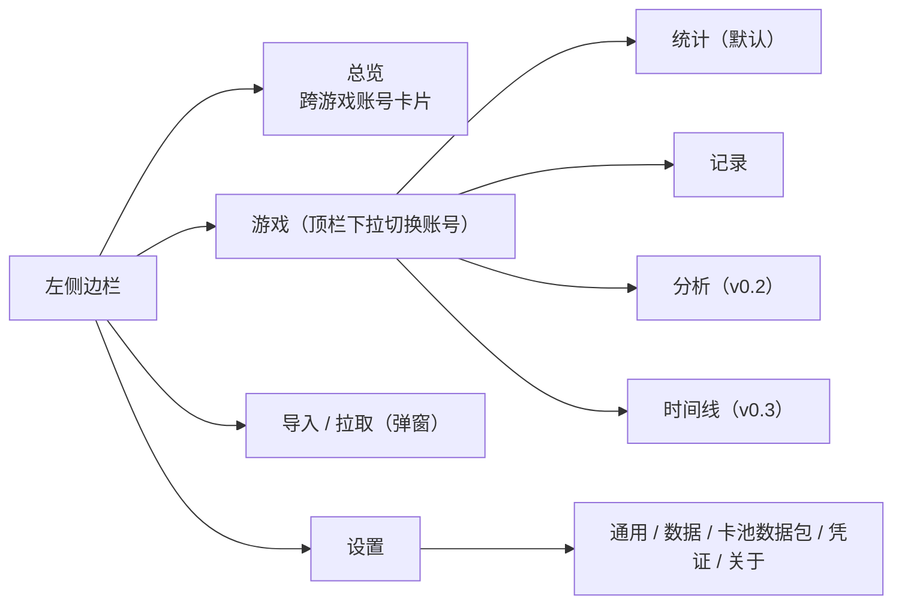
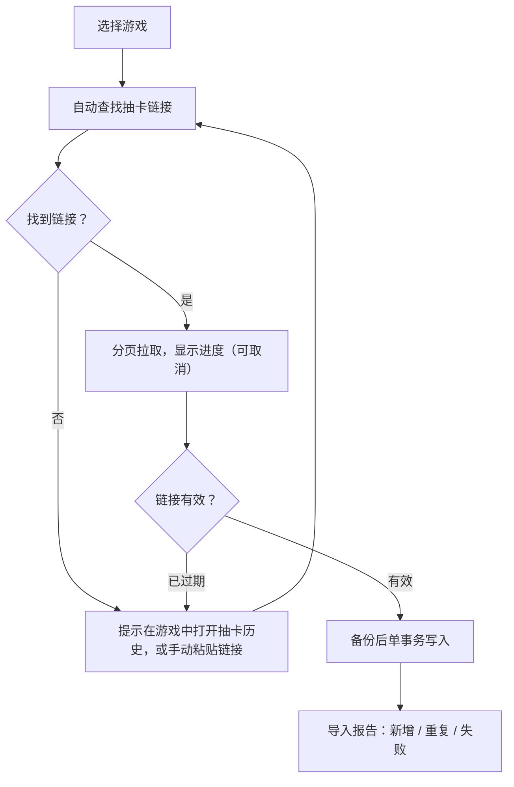

# GachaNote UI/UX 设计文档

2026-10-24 · Can（2026-10-25 细化页面布局）

## 1. 设计原则

GachaNote 是一个「打开就看到保底」的工具：任何账号的当前保底、平均出 UP、歪率，都应该在启动后一次点击内看到。

1. **数字优先**：三项核心指标永远是页面上字号最大的元素，图表和列表是对它们的解释。
2. **简洁工具风**：白（或深灰）底、细边框卡片、无渐变和阴影，信息密度参考 HoYo.Gacha。
3. **一款游戏一个主题色**：只用在边栏图标、卡片左侧色条和选中态，不铺满背景。
4. **星级用颜色表达**：金 / 紫 / 蓝三色在各游戏中含义一致，首版不显示角色头像。
5. **所有写入都可追溯**：导入和拉取结束后一定显示报告，写入前已自动备份。

**不做**：立绘背景、抽卡动画、音效、引导气泡式新手教程。

## 2. 信息架构

边栏只有四类入口：总览、游戏列表、导入按钮、设置。边栏只列游戏，同一游戏的多个账号在页面顶栏的下拉菜单里切换。账号详情用标签页承载后续版本的功能，新增功能不增加边栏条目。

图 2-1 信息架构：

导入是弹窗而不是页面：从总览、账号详情或边栏都能打开，完成后回到原页面并刷新数字。

## 3. 主要页面

每页的区域从上到下列出；可点击的样子见 [GachaNote 原型](https://claude.ai/artifact/YU8T1foMKWdjiNqu3PRe98)（源文件在 [prototype/](prototype/)）（示例数据，可切换深浅色）。窗口结构统一为：左侧边栏 240 px（可收起到 64 px 只显示图标）+ 右侧内容区，内容区最大宽度 1200 px 居中。右侧内容区分上下两块：上方是固定顶栏（页面标题、账号切换、页面操作按钮；账号详情还包括标签页），白底并以分割线和下方隔开，不随内容滚动。所有页面的顶栏高度统一为 120 px：上行为 32 px 图标 + 标题 + 一行辅助说明，下行 40 px 放标签页或筛选标签（设置等没有第二行的页面留空）；下方是可滚动的内容。边栏也独立滚动。

### 3.1 左侧边栏

1. 顶部：应用图标 + 应用名 + 版本号小标签，下方「导入 / 拉取」主按钮（带下载图标）。应用图标为四角星形的浅蓝晶石，金色描边，灵感来自抽卡货币但为自绘原创图形，不使用任何游戏的官方素材。
   - 导航项统一左侧 24 px 图标位：总览用网格图标，游戏用游戏图标，「添加游戏」用虚线框加号；选中项为浅主色底 + 左侧 3 px 主色竖条；账号数放在右侧小胶囊里；「游戏」分组标题上方加分割线。
2. 总览入口。
3. 游戏列表：每款游戏一行（游戏图标 + 名称 + 账号数），不展开账号。点击进入该游戏上次查看的账号；账号在页面顶栏的下拉菜单里切换（见 3.3）。没有账号的游戏默认隐藏。列表末尾有「+ 添加游戏」，点击后展开未显示的游戏列表，选中的游戏出现在边栏，并显示「暂无账号 · 去导入」；导入或拉取到该游戏的记录时也会自动显示。游戏行的右键菜单可「从边栏隐藏」（仅限没有账号的游戏）。
4. 底部：设置、主题快速切换两个并排的图标按钮（齿轮；浅色时显示月亮、深色时显示太阳），悬停显示文字提示。

### 3.2 总览

1. 顶栏：标题「总览」、「全部刷新」按钮；第二行为游戏筛选，样式与账号详情的标签页一致（文字 + 选中下划线，贴着顶栏分割线），每个游戏前加 8 px 主题色圆点，「全部」在最前。
2. 账号卡片网格（每行 3 张，窗口变窄时 2 张或 1 张）。卡片内容：
   1. 顶部 3 px 游戏主题色条；头部为游戏图标、「游戏名 · 备注名」、UID 与最后更新时间，右上角为「>」图标按钮进入账号详情。
   2. 默认两行：角色限定池、武器类限定池（武器 / 光锥 / 音擎等），每个卡池是一块浅底圆角小面板：池名 + 大 / 小保底标签，右侧保底数（当前值加粗放大、「/ 90」灰色），下方 8 px 进度条用游戏主题色。其余卡池（集录、常驻、新手等）收在「展开」里。只有一个限定池的游戏只显示一行。
   3. 底部：总抽数、平均出 UP、歪率三等分，每格上方小字标签、下方加粗数值，格间竖线分隔，底色为该游戏主题色的浅色调（约 9% 不透明度），和页面背景区分开，始终贴在卡片最下方；同一行卡片等高，卡池行数不同时底部仍对齐。
3. 空状态：一句说明 + 「从游戏拉取」「导入文件」两个按钮。

### 3.3 账号详情 · 统计（默认标签）

1. 顶栏：游戏名 + 账号下拉菜单（备注名 + UID，UID 可点击复制；菜单末尾「+ 导入新账号」）、最后更新时间、「更新记录」按钮、更多菜单（导出、生成分享图（v0.3）、重命名、删除）。只有一个账号时下拉箭头不显示。
2. 标签页：统计 / 记录 / 分析 / 时间线（未开放的版本不显示）。
3. 卡池类型切换（分段控件）：如「总览 / 角色 37 / 武器 12 / 常驻 55」，每个分段直接带当前保底数，不用切换就能看到各池保底。选中的卡池在统计、记录、分析、时间线标签之间共用，切换标签不重置。「总览」分段只在统计标签出现，且为进入账号时的默认选项；其他标签需要具体卡池，从总览切过去时显示第一个卡池。
4. 选中「总览」时显示该账号全部卡池的汇总，替代下面第 5–7 项：
   1. 汇总指标行：总抽数（全部卡池）、出金数、平均出金、记录时间范围。
   2. 卡池卡片网格，每个卡池一张：池名、当前保底「37 / 90」+ 进度条、「大保底」标签（如有）、总抽数和两项按规则模板选取的指标（限定池为平均出 UP、歪率或「井」，常驻池为平均出金、出金数），「查看详情」切到该卡池。总览不显示出金历史，出金记录在各卡池里查看。

选中具体卡池时显示：

5. 核心指标行，三张大数字卡。卡片内容由该游戏的规则模板决定，以原神角色池为例：
   1. 当前保底：大字「37」+ 小字「/ 90」，下方进度条和「小保底 / 大保底」状态。
   2. 平均出 UP：大字「88.4 抽」，下方「共 12 个 UP」。
   3. 歪率：大字「42%」，下方「5 / 12 次小保底」。

   游戏没有的指标不显示空卡，而是换成该游戏自己的机制，例如明日方舟限定池没有大保底，第三张卡显示「井 180 / 300」。常驻池没有 UP，只显示当前保底和平均出金两张卡。
6. 次级指标行：总抽数、金 / 紫数量与占比、平均出金。v0.2 起在此行加入一句话结论「下一抽出金 0.6%」「欧 · 前 22%」，点击跳到分析标签。
7. 出金历史：按时间倒序的横向列表，每项「图标位 · 物品名 · 抽数 · UP / 歪」，抽数越多条越长。抽数条按欧非分三色：低于该卡池理论平均出金抽数的 85% 为绿 #22C55E（欧），高于 115% 为红 #F43F5E（非），其余为黄 #FBBF24（接近平均）；深浅主题用同一组亮色。标题右侧放三色图例。抽数数字始终显示，不只靠颜色区分。图标位 24 px，首版留空但保留宽度，以后头像随卡池数据包下载后补上，布局不用改。

### 3.4 账号详情 · 记录

1. 筛选栏：卡池类型、星级（多选，选项用各游戏实际叫法：明日方舟 / 终末地为 6–3 星，绝区零为 S / A / B 级，其余为 5–3 星）、时间范围、名称搜索、「只看金」快捷开关。
2. 表格列：时间、卡池、物品名（按星级着色，左侧 24 px 图标位，同 3.3）、类型、星级、当次抽数（仅金和紫）、UP / 歪标记。
3. 表头使用区别于表体的浅灰底色（浅色 #F1F1F4，深色 #25272C），行悬停高亮。
4. 分页：表格下方显示「共 N 条 · 第 x / y 页」、页码按钮（上一页 / 页码 / 下一页）和「每页 20 / 50 / 100 条」选择，默认 20 条；修改筛选条件时回到第 1 页。
5. 当前页行数超过可视高度时，只在表格内部滚动：表格区域最大高度为窗口高度减去顶栏、筛选栏和分页栏（最小 320 px），表头固定在顶部；分页栏始终可见。

### 3.5 账号详情 · 分析（v0.2）

卡池沿用 3.3 的分段控件选择。从上到下：

1. 概率预测：「下一抽出金 / 出 UP 概率」两个大数字；下面一行「未来 N 抽内」的出金 / 出 UP 概率，N 可输入（默认 10），旁边是 0 到保底上限的累计概率曲线，当前位置用竖线标出。
2. 欧非评价 + 抽卡构成（同一行两张卡）：
   - 欧非评价：评级 + 百分位（「比 78% 的人运气好」）和理论平均对比；样本少于 5 个金时只显示数值。
   - 抽卡构成：环形图显示三档星级占比，中间是总抽数；右侧列出各档数量和百分比，最高星下方再写「其中 UP x · 歪 y」，底部一行「平均每 x 抽出一个金」。星级叫法跟随游戏（方舟、终末地为 6 星 / 5 星 / 4 星及以下，绝区零为 S / A / B 级）。
3. 出金分布图：每次出金一根柱子，按时间排列，高度为抽数，颜色区分 UP / 歪，并画出理论平均线。
4. 成就：按当前卡池的出金记录计算的徽章卡片，已达成的用金色底，未达成的半透明并写出进度。首批四个：欧皇时刻（某个金的抽数 ≤ 硬保底的 35%）、非酋时刻（进入软保底 5 抽后才出金）、不歪连胜（连续 3 个金都是 UP，常驻池不显示）、漫长等待（两次出金相隔 ≥ 45 天）。阈值放在规则模板里，可调。没有出金记录时整张卡隐藏。
5. 抽卡时间线：默认「按日」，从第一条记录到今天每天一根柱子，按三档星级堆叠（蓝 / 紫 / 金）；标题写日期范围和总抽数，图例写各档数量，抽数最多的一天在柱顶标出数字。鼠标悬停时，在所在日期画一条竖直虚线并高亮该柱，旁边弹出浮框：日期、当日抽卡次数、各星级数量（带色点）；浮框在图表右侧 40% 时改为显示在虚线左边，移出图表后消失。触屏上点一下柱子显示同样的浮框。图下方是时间筛选：一条缩略图显示全部日期的抽数，选区外加灰色遮罩，选区用主色边框框出，两端各有一个可拖动的手柄（键盘可用方向键调整）；缩略图下面是快捷按钮「近 30 天 / 近 90 天 / 近半年 / 全部」和已选日期范围。主图的标题、图例、纵轴、峰值标记都只按选区内的数据计算。选区按「距今天几天」保存，切换卡池后仍然生效。右上角可切到「按月」（每月抽数柱 + 出金数）。

分析页参考了 voderl/genshin-gacha-analyzer 的构成饼图、成就卡片和按日时间图（该项目没有许可证，只借鉴思路，不使用其代码和素材）。

每张图右上角可切换为数据表（见第 6 节无障碍）。

### 3.6 账号详情 · 时间线（v0.3）

纵向列表，最新一期在最上面，每期一张卡片：

1. 起止日期、UP 物品名（按星级着色）。
2. 本期抽数、本期获得的金（物品名 + 抽数 + UP / 歪）。
3. 本期没抽的卡池默认折叠成一行「未参与」，可在顶部开关「显示未参与的卡池」。

没有卡池元数据时，按记录时间自动分段，卡片标题显示为「2026-10-01 – 10-21 的记录」。

### 3.7 分享图（v0.3）

从账号顶栏「更多 → 生成分享图」打开预览弹窗，左侧为预览，右侧为选项。

1. 内容：游戏名 + 备注名、当前卡池的三项核心指标、最近 10 个出金（物品名 · 抽数 · UP / 歪）、生成日期和应用名。
2. 选项：隐藏 UID（默认开）、深色 / 浅色、卡池切换。
3. 导出固定 1080 px 宽的 PNG，「保存」和「复制到剪贴板」两个按钮。

跨游戏的总览分享图暂不做。

### 3.8 导入 / 拉取弹窗

1. 第一步：选择游戏，六款游戏各一张卡片（图标 + 名称 + 可用方式）。下方有「直接导入文件，自动识别游戏」入口，用于包含多款游戏的 UIGF 文件，跳过第二步。
2. 第二步：只列出这款游戏可用的方式，顶部显示所选游戏和「更换游戏」：

   | 游戏 | 可用方式 |
   | --- | --- |
   | 原神、崩坏：星穹铁道、绝区零 | 从游戏拉取（自动查找链接，可粘贴）、导入文件（UIGF） |
   | 鸣潮 | 从游戏拉取（从 Client.log 查找链接，可粘贴）、导入文件（GNJ） |
   | 明日方舟、明日方舟：终末地 | 登录鹰角账号（推荐，v0.2）、手动粘贴 token（v0.2）、导入文件（CSV / GNJ） |

3. 第三步：准备，按方式分别为确认找到的链接或粘贴链接、拖入或选择文件并预览、在登录窗口登录鹰角账号、粘贴 token。
4. 第四步：进度（当前卡池、已获条数），可取消。
5. 第五步：导入报告（新增 / 重复 / 失败、新建账号、备份位置），「查看账号」按钮。

从账号详情的「更新记录」、账号下拉的「+ 导入新账号」或空游戏页打开时，已知游戏，直接从第二步开始。

### 3.9 设置

左侧分组导航（通用 / 数据 / 卡池数据包 / 凭证 / 关于），右侧为表单。「凭证」页列出已保存的 token（只显示保存时间，不显示内容）和「清除」按钮。

## 4. 关键流程

四个流程都以「导入报告」结束，失败时给出下一步做什么，而不是错误码。

### 4.1 从游戏拉取（米哈游三款、鸣潮）

图 4-1 从游戏拉取：

用户在同一个弹窗里完成全部步骤；拉取中可取消，取消后不写入。

### 4.2 首次使用

1. 启动后进入总览空状态，语言和主题已跟随系统。
2. 点「从游戏拉取」或「导入文件」，走 4.1 或 4.3。
3. 报告页点「查看账号」，直接进入该账号的统计标签。没有单独的创建账号步骤，账号由导入自动创建。

### 4.3 文件导入

1. 拖入或选择文件，自动识别格式（UIGF / GNJ / CSV）。
2. 预览：列出文件里的游戏、UID 和条数，用户可取消勾选。
3. 确认后写入，显示报告；格式校验失败时停在预览步并指出具体行号。

### 4.4 鹰角 token 拉取（v0.2）

默认方式是「登录鹰角账号」，「手动粘贴 token」作为备用，两种方式拿到 token 后的步骤相同。

1. 登录鹰角账号：点击后应用弹出独立的内嵌浏览器窗口，打开鹰角官网登录页。窗口顶部固定一行提示「登录在鹰角官网页面完成，GachaNote 不接触密码，只保存登录后的 token」。验证码、短信等都由官网处理。
2. 登录成功后应用自动读取 token 并关闭窗口；用户关闭窗口或 5 分钟未完成登录时，回到方式选择，并提示可改用「手动粘贴 token」。
3. 手动粘贴 token（备用）：弹窗内给出「如何获取 token」的 3 步说明和打开鹰角官网的按钮，粘贴后继续。
4. 拿到 token 后自动列出该账号下的明日方舟、终末地角色，默认全选。
5. 勾选「记住 token」时加密保存，下次可一键更新；token 失效时回到第 1 步。

从登录窗口取 token 的具体办法（读 cookie 或在页面内请求账号接口）需在开发前先做技术验证；官网改版导致自动获取失效时，手动粘贴和文件导入仍可用。

## 5. 视觉规范

所有颜色、字号、间距都定义为 CSS 变量（design token），深浅色主题只切换变量值，组件不写死颜色。色值为初稿，可在原型里直接看效果。

### 5.1 基础色

| Token | 浅色 | 深色 | 用途 |
| --- | --- | --- | --- |
| --bg | #F7F7F8 | #141518 | 窗口背景 |
| --surface | #FFFFFF | #1D1F23 | 卡片、边栏 |
| --border | #E4E4E7 | #2E3036 | 边框、分割线 |
| --text | #18181B | #ECECEE | 正文 |
| --text-2 | #6B6B73 | #9A9AA3 | 辅助文字 |
| --primary | #3B6FE0 | #6E93F0 | 主按钮、选中态 |
| --danger | #D64545 | #F06A6A | 删除、错误 |

### 5.2 星级色与游戏主题色

| 类别 | 名称 | 色值 | 用途 |
| --- | --- | --- | --- |
| 星级 | 金（最高星） | #E3A43B | 物品名、抽数条 |
| 星级 | 紫（次高星） | #9466E0 | 物品名 |
| 星级 | 蓝 / 更低 | #5A8DEE / #9AA0A6 | 物品名 |
| 图表 | 星级堆叠 / 环形图（蓝 · 紫 · 金） | 浅色 #4A90E2 · #9B5DE5 · #F5B83D；深色 #5A9BEA · #A97AF0 · #F2C14E | 抽卡构成、按日时间线；比文字色更亮 |
| 状态 | UP | #2FA36B | UP 标签 |
| 状态 | 歪 | #D64545 | 歪标签 |
| 状态 | 大保底 | 金色渐变实底 #F7D27A → #E2A73C，深棕字 #4A3000，轻微投影，前置带勾的实心盾牌图标 | 大保底标签 |
| 状态 | 小保底 | 透明底 + 1 px 边框色描边，辅助文字色，前置空心盾牌图标 | 小保底标签 |
| 游戏 | 原神 | #C8A464（金） | 边栏圆点、卡片色条 |
| 游戏 | 崩坏：星穹铁道 | #6F6BD9（星穹紫蓝） | 同上 |
| 游戏 | 绝区零 | #B5D800（荧光黄绿） | 同上 |
| 游戏 | 明日方舟 | #2F8FE0（罗德岛蓝） | 同上 |
| 游戏 | 明日方舟：终末地 | #F2C200（工业黄） | 同上 |
| 游戏 | 鸣潮 | #3FBFA8（青绿） | 同上 |

星级和 UP / 歪的颜色在所有游戏中含义一致；游戏主题色取各游戏的印象色，只用于识别是哪款游戏，不用于文字。原神金与终末地黄色相近，靠游戏图标区分。UP / 歪标签同时带文字，不只靠颜色区分。大 / 小保底标签尺寸相同，为 22 px 高、12 px 字的圆角胶囊，只在有大小保底机制的卡池显示（明日方舟、常驻池不显示），出现在总览卡片的池名后、账号总览卡池卡片右上角和「当前保底」指标卡标题右侧。

**游戏图标**：边栏和总览卡片使用 24 px 圆角方形图标（圆角 6 px）。图标为各游戏官方应用图标，属于厂商的商标素材，放在卡池数据包里下载，不进安装包；未下载时显示主题色底 + 游戏首字的占位图标（原 / 铁 / 零 / 舟 / 终 / 潮）。

### 5.3 字体、间距、圆角

| 项目 | 规范 |
| --- | --- |
| 字体 | 系统字体：Microsoft YaHei UI、Segoe UI；数字使用等宽数字（tabular-nums） |
| 大数字 | 36 px / 600，仅用于三项核心指标 |
| 页面标题 | 22 px / 600（顶栏内，下方配一行 12 px 辅助说明） |
| 卡片标题 | 15 px / 600 |
| 正文 | 14 px / 400，行高 1.5 |
| 辅助文字 | 12 px / 400 |
| 间距 | 4 px 基准：4 / 8 / 12 / 16 / 24 / 32 |
| 圆角 | 卡片 8 px，按钮与输入框 6 px，标签 999 px |
| 滚动条 | 全局细滚动条：8 px 宽，透明轨道，滑块为边框色圆角条，悬停时变为辅助文字色 |
| 动效 | 只用于状态变化，时长 150 ms；系统开启「减少动画」时关闭 |

## 6. 交互规范

每种状态都告诉用户「现在怎样、下一步做什么」；会丢数据的操作才弹确认框。

| 场景 | 规范 |
| --- | --- |
| 空状态 | 一句说明 + 最多两个操作按钮；不放插图 |
| 加载 | 超过 300 ms 才显示骨架屏；导入和拉取用带文字的进度条（当前卡池、已获条数） |
| 成功反馈 | 小操作（复制 UID、切换主题）用右下角轻提示，3 秒后消失；导入用报告页 |
| 错误提示 | 句式「发生了什么 + 怎么做」，如「抽卡链接已过期，请在游戏中重新打开抽卡历史」；技术详情折叠在「详情」里 |
| 分段控件 | 卡池切换、主题、分享图选项等统一样式：浅灰底的圆角槽（3 px 内边距），按宽度包裹内容不拉满整行；选中项为白底卡片带轻微阴影，未选中为灰字无底；卡池分段的保底数放在右侧小胶囊里，选中时变主色 |
| 下拉框 | 不用系统原生下拉，统一自绘：34 px 高、6 px 圆角、右侧箭头，展开时箭头翻转、边框变主色并加浅色外圈；选项列表为带阴影的浮层，选中项前打勾、主色文字。单选选中后收起，多选（如星级）保持展开，全选时显示「全部」 |
| 确认弹窗 | 仅用于删除账号、清除凭证、迁移数据目录；危险按钮用红色并写明后果，如「删除 1,234 条记录」 |
| 数字格式 | 千分位分隔；百分比保留 1 位小数；平均抽数保留 1 位小数 |
| 时间格式 | 列表用「2026-10-24 16:12」；最后更新用相对时间「3 小时前」，悬停显示绝对时间 |
| 快捷键 | Ctrl+I 导入 / 拉取；Ctrl+R 更新当前账号；Ctrl+F 记录搜索；Ctrl+, 设置；Ctrl+1–4 切换账号标签页 |
| 无障碍 | 所有操作可键盘完成；文字与背景对比度 ≥ 4.5:1；图表提供数据表替代视图 |
| 多语言 | 文案全部来自语言包；按英文比中文长 40% 预留宽度；物品名用卡池数据包中对应语言的名称 |

**术语对照**（界面统一用法）：保底 / Pity，小保底 / 50-50，大保底 / Guaranteed，歪 / Lost 50-50，出金 / Top-rarity pull，卡池 / Banner。各游戏自己的叫法（祈愿、跃迁、调频、寻访、唤取）只用在卡池名称上。

## 7. 响应式与移动端预留

桌面端按三档宽度布局，最窄一档就是以后手机端的布局，组件不用重做。

| 窗口宽度 | 边栏 | 总览卡片 | 核心指标 |
| --- | --- | --- | --- |
| ≥ 1280 px | 展开 240 px | 每行 3 张 | 一行 3 张 |
| 1024–1279 px | 收起 64 px（只显示图标） | 每行 2 张 | 一行 3 张 |
| < 768 px（手机端） | 改为底部导航：总览 / 游戏 / 导入 / 设置 | 每行 1 张 | 纵向堆叠 |

手机端只显示精简内容，完整信息点进去再看：

| 视图 | 手机端显示 |
| --- | --- |
| 总览卡片 | 只显示角色限定池一行 + 总抽数；其余收在「展开」里 |
| 统计 | 核心指标卡改为一行三格小数字；次级指标收进「更多数据」；出金历史只显示最近 5 个 |
| 记录 | 表格改为列表，每行只显示物品名、抽数、UP / 歪，点击看详情 |
| 分析 | 概率预测只显示数字，曲线收起；图表默认显示最近 12 个月 |
| 时间线 | 卡片只显示日期、UP 物品名和本期抽数 |
| 图标位 | 隐藏 |

- 所有可点击元素最小 32 × 32 px（手机端 44 × 44 px）。
- 不依赖悬停传递信息：悬停显示的内容在点击后也能看到。
- 桌面端特有的「自动查找游戏目录」在手机端隐藏，只保留粘贴链接和文件导入。
