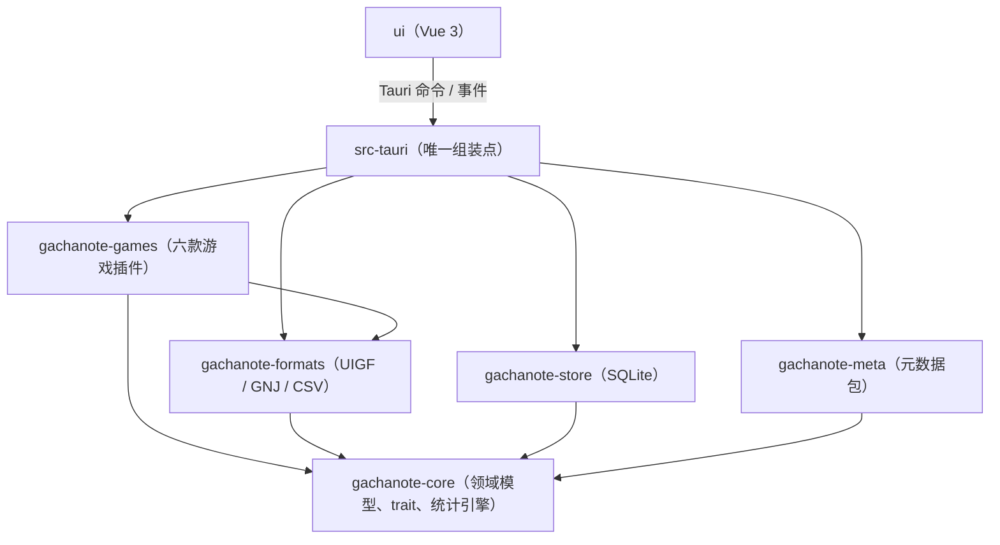
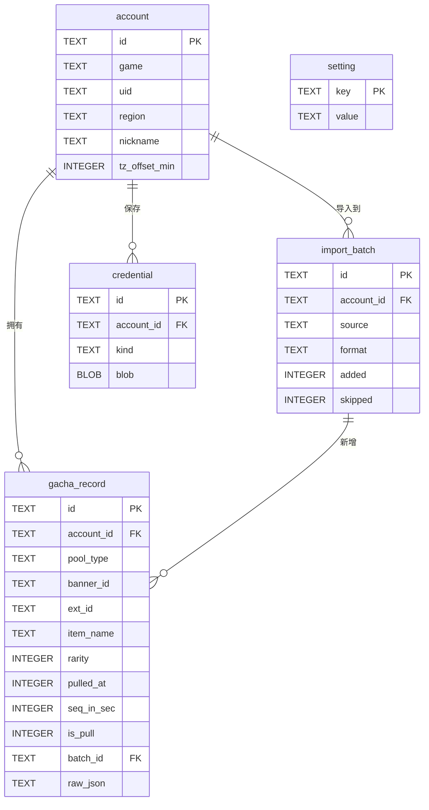
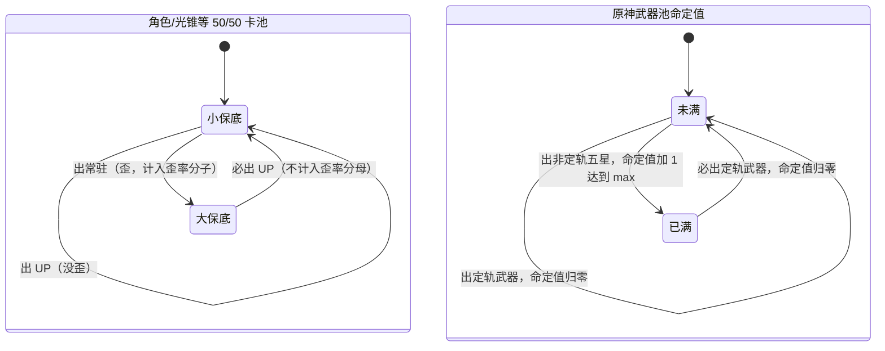
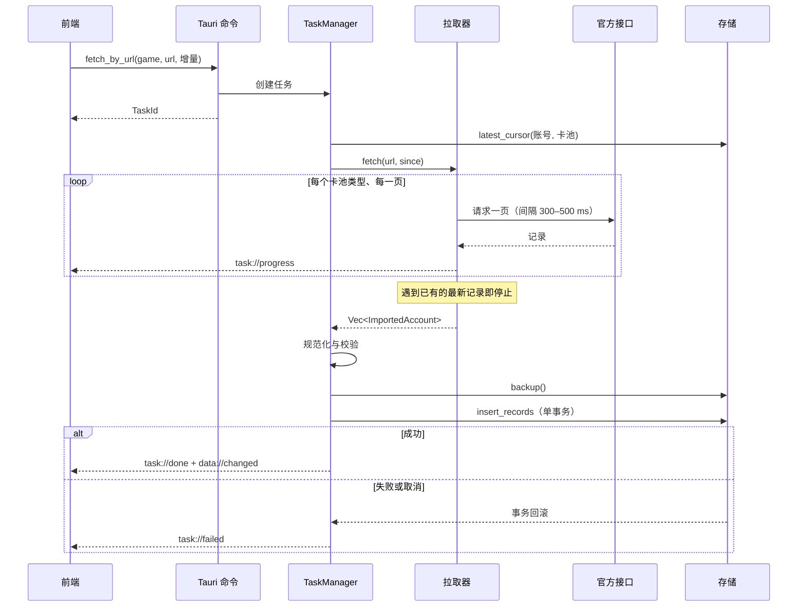

# GachaNote 架构设计文档

2026-10-24 · Can

## 1. 概述与技术选型

本文档描述 GachaNote 的软件架构，承接《功能需求》与《SRS》，为开发计划和编码提供依据。UI/UX 与原型仍可能调整，本文档只约束到接口层，不依赖具体页面布局。

### 1.1 架构目标

- **核心与外壳分离**：所有业务逻辑放在不依赖 Tauri 的 Rust 库中，桌面端、后续手机端（Tauri mobile）乃至服务器端都复用同一套核心。
- **游戏即插件**：每款游戏由「规则模板 + 拉取器 + 格式转换器」三件组成，新增游戏不改核心代码。
- **存储可替换**：上层只依赖 `RecordRepository` 等 trait，当前实现为本地 SQLite，后续可换成远程服务。
- **数据安全优先**：导入走单事务、导入前自动备份、凭据加密存储、日志不含敏感信息。

### 1.2 技术选型

| 层 | 选型 | 理由 |
| --- | --- | --- |
| 应用外壳 | Tauri 2 | 安装包小（目标 ≤20 MB），原生 WebView2，支持后续移动端 |
| 核心语言 | Rust 2021，stable | 性能、内存安全，参考项目 HoYo.Gacha 同栈 |
| 异步运行时 | tokio | Tauri 2 默认运行时 |
| HTTP | reqwest（rustls） | 拉取官方接口，统一代理与超时 |
| 序列化 | serde / serde\_json / csv | UIGF、GNJ、CSV 读写 |
| 数据库 | SQLite + rusqlite（bundled） | 单文件、零部署；同步 API 放在专用线程，简单可靠 |
| 迁移 | rusqlite\_migration | 版本化 SQL 迁移 |
| 错误 | thiserror（库）+ anyhow（仅应用层） | 库内类型化错误，前端可按错误码展示 |
| 日志 | tracing + tracing-appender | 按天滚动，敏感字段脱敏 |
| 凭据加密 | windows crate（DPAPI） | 绑定当前 Windows 用户，无需自管密钥 |
| 前端框架 | Vue 3 + TypeScript + Vite | 用户指定 |
| 状态管理 | Pinia | Vue 官方推荐 |
| 路由 | vue-router | 侧边栏导航对应路由 |
| 国际化 | vue-i18n | 中英双语 |
| 图表 | ECharts（按需引入） | 出金分布、月度趋势、概率曲线 |
| 长列表 | vue-virtual-scroller | 记录列表 10 万条流畅滚动 |
| 前后端类型 | specta + tauri-specta | 从 Rust 类型生成 TS 定义，避免两边不一致 |

## 2. 仓库结构与 crate 划分

采用 Cargo workspace + 前端单包的单仓库（monorepo）结构：

```text
GachaNote/
├─ Cargo.toml              # workspace
├─ crates/
│  ├─ gachanote-core/      # 领域模型、插件 trait、统计引擎、导入导出管线
│  ├─ gachanote-store/     # RecordRepository 的 SQLite 实现与迁移
│  ├─ gachanote-games/     # 六款游戏插件（按 feature 分模块）
│  │  └─ src/{genshin,starrail,zzz,arknights,endfield,wuwa}/
│  ├─ gachanote-formats/   # UIGF v2–v4.2 / SRGF / GNJ / CSV 编解码
│  └─ gachanote-meta/      # 卡池元数据包的下载、校验、缓存
├─ src-tauri/              # Tauri 外壳：命令、事件、窗口、DPAPI、更新
├─ ui/                     # Vue 3 前端
├─ metadata/               # 卡池元数据包（manifest.json + <game>.json + icons/）
├─ docs/                   # 需求、SRS、UI/UX、架构、计划
└─ .github/workflows/      # CI 与发布
```

### 2.1 依赖规则

- `core` 不依赖任何其他内部 crate，也不依赖 Tauri、SQLite、reqwest 的具体实现，只定义 trait 与纯逻辑。
- `formats`、`games`、`store`、`meta` 依赖 `core`，彼此之间不互相依赖（`games` 可依赖 `formats` 复用编解码）。
- `src-tauri` 是唯一的组装点：注册插件、创建存储、注入到 `AppState`。
- 后续手机端新建一个 Tauri mobile 外壳，或服务器端新建一个 axum 外壳，都只需重新组装，不改下层 crate。

图 2-1 crate 依赖关系（箭头指向被依赖方，`core` 位于最底层）：



### 2.2 平台相关代码

读取游戏缓存与日志路径、DPAPI 等 Windows 专属逻辑用 `#[cfg(windows)]` 隔离，并通过 `PathProvider`、`SecretStore` trait 注入，便于在 Linux CI 上测试和后续移植。

## 3. 游戏插件接口

每款游戏实现一个 `GamePlugin`：规则模板（必须）、官方卡池类型代码到内部卡池类型的映射（必须）、可选的拉取器。文件格式转换器跨游戏通用（一个 UIGF v4 文件可含三款游戏，GNJ 可含任意游戏），所以不挂在插件下，而是单独注册。插件与转换器在 `src-tauri` 启动时注册到 `PluginRegistry`，前端通过 `list_games` 拿到游戏列表和各自支持的导入方式。

```rust
pub trait GamePlugin: Send + Sync {
    fn id(&self) -> GameId;                  // "genshin" | "starrail" | "zzz" | "arknights" | "endfield" | "wuwa"
    fn info(&self) -> GameInfo;              // 厂商、主题色、卡池类型列表、拉取方式、支持的格式
    fn rules(&self) -> &[PoolRule];          // 每种卡池类型一份规则模板，可按生效日期分段
    fn pool_type(&self, official: &str) -> Option<PoolTypeId>; // 官方卡池代码 → 内部卡池类型（即保底组）
    fn validate_uid(&self, uid: &str) -> bool { /* 默认：非空字母数字 */ }
    fn fetcher(&self) -> Option<&dyn Fetcher> { None }
    fn classify(&self, rec: &NewRecord, meta: &GameMeta) -> Classified { meta.classify(rec) } // 是否 UP
}

#[async_trait]
pub trait Fetcher: Send + Sync {
    fn kind(&self) -> FetchKind;             // Url | AccountToken
    async fn discover(&self, env: &dyn PathProvider) -> Result<Vec<FetchSource>>; // 自动查找 URL / 已保存凭据
    async fn fetch(&self, src: &FetchSource, since: &dyn SinceLookup, // 拿到 UID 后查该账号各卡池类型的最新 Cursor
                   progress: &dyn Progress, cancel: &CancelToken) -> Result<Vec<ImportedAccount>>;
}

pub trait SinceLookup: Send + Sync {         // 米哈游链接里没有 UID，只能边拉边查
    fn since(&self, game: &GameId, uid: &str) -> Result<Since>; // Since = 每个卡池类型的最新 Cursor，空则全量
}

pub trait Converter: Send + Sync {
    fn format(&self) -> FormatId;            // UigfV4 | UigfV3 | UigfV2 | SrgfV1 | Gnj | AkExportCsv | GnCsv
    fn sniff(&self, head: &[u8]) -> bool;    // 自动识别文件格式（先看文件开头 4 KB，识别不出再看整个文件）
    fn decode(&self, input: &mut dyn Read) -> Result<Vec<ImportedAccount>>; // 个别记录不合法时放进 failures
    fn encode(&self, data: &[ExportAccount], out: &mut dyn Write) -> Result<()>; // 只导入的格式返回 Invalid
}
```

转换器只做与格式有关的换算（时区换算成 UTC、方舟星级 0–5 → 1–6），记录的卡池类型以官方代码（`PoolRef::Official`）交给插件映射；GNJ 和自有 CSV 存的已是内部卡池类型（`PoolRef::Normalized`）。

### 3.1 规则模板

规则模板是纯数据，可以写死在插件里，也可以被元数据包覆盖（游戏调整参数时不必发版）。用枚举组合覆盖 SRS 第 5 节的所有机制：

```rust
pub struct PoolRule {
    pub pool_type: PoolTypeId,
    pub rarity_top: u8,                      // 5 或 6
    pub curve: PityCurve,                    // 基础概率 p0、软保底起点 s、每抽增量 d、硬保底 h
    pub up: UpRule,                          // None | FiftyFifty{rate, guarantee_next} | Fixed{rate}
    pub extras: Vec<Mechanic>,               // 可叠加的特殊机制
    pub pity_scope: PityScope,               // SharedByType（同类卡池继承）| PerBanner（每期重置）
}

pub enum Mechanic {
    EpitomizedPath { max: u8 },              // 原神武器池命定值（规则按版本分段：2.0 前无、5.0 前上限 2、之后上限 1）
    UpWithinN { n: u32, per_banner: bool },  // N 抽内必出 UP（终末地 120 抽每期清零；方舟登场限定 150 抽跨期一次性）
    Spark { n: u32 },                        // 每 N 抽可自选（方舟限定池、崩铁 / 绝区零常驻 300 抽）
    FreePulls,                               // 免费抽不计入保底（终末地，记录 is_pull = false）
    CapturingRadiance,                       // 原神 5.0 起角色池「捕获明光」（只影响概率预测）
}
```

新增游戏时，若现有 `Mechanic` 不够用，新增一个变体并在统计引擎里实现其状态转移，这是唯一需要改 `core` 的情况。

### 3.2 各游戏插件一览

| 游戏 | 拉取器 | 转换器 | 特殊处理 |
| --- | --- | --- | --- |
| 原神 | URL（WebView 磁盘缓存） | UIGF v2–v4.2 | 301 / 400 共用角色池保底；命定值按版本分段；集录祈愿（500）不判 UP |
| 崩铁 | URL（WebView 磁盘缓存） | UIGF v4 / SRGF v1 | 光锥池 75% UP；联动跃迁（21 / 22）单独计保底；常驻 300 抽自选 |
| 绝区零 | URL（WebView 磁盘缓存） | UIGF v4 | 4 位卡池代码按首位归类；邦布频段；102 / 103 单独计保底、不判 UP |
| 明日方舟 | 鹰角账号 token（v0.2） | GNJ / arknights-gacha-export CSV | 按 poolId 前缀归类（`NORM` / `DOUBLE` 为标准寻访）；歪率按非 UP 六星占比 |
| 终末地 | 鹰角账号 token（v0.2） | GNJ / CSV | 卡池代码为 `char:<poolId>` / `weapon:<poolId>`；isFree 不计保底；120 抽必出 UP |
| 鸣潮 | URL（Client.log） | GNJ | 官方、Steam、Epic 三种安装路径；仅保留 6 个月；武器池不歪 |

## 4. 数据库设计

单个 SQLite 文件 `%APPDATA%/GachaNote/gachanote.db`，开启 WAL 与外键。主键一律用 UUID v7（按时间有序，利于索引，将来同步到服务器也不冲突），时间一律存 UTC 毫秒。

```sql
CREATE TABLE account (
  id            TEXT PRIMARY KEY,
  game          TEXT NOT NULL,              -- GameId
  uid           TEXT NOT NULL,
  region        TEXT,                       -- cn / global / server code
  nickname      TEXT,
  tz_offset_min INTEGER NOT NULL DEFAULT 480,
  created_at    INTEGER NOT NULL,
  UNIQUE (game, uid)
);

CREATE TABLE import_batch (
  id         TEXT PRIMARY KEY,
  account_id TEXT REFERENCES account(id) ON DELETE CASCADE,
  source     TEXT NOT NULL,                 -- file | url | token
  format     TEXT,                          -- FormatId
  file_name  TEXT,
  added      INTEGER NOT NULL,
  skipped    INTEGER NOT NULL,
  started_at INTEGER NOT NULL,
  finished_at INTEGER
);

CREATE TABLE gacha_record (
  id          TEXT PRIMARY KEY,
  account_id  TEXT NOT NULL REFERENCES account(id) ON DELETE CASCADE,
  pool_type   TEXT NOT NULL,                -- 规范化后的卡池类型
  banner_id   TEXT,                         -- 具体哪一期，可空，由元数据包推断
  ext_id      TEXT,                         -- 官方记录 ID，无则为 NULL
  item_id     TEXT,
  item_name   TEXT NOT NULL,
  item_type   TEXT,
  rarity      INTEGER NOT NULL,
  pulled_at   INTEGER NOT NULL,             -- UTC ms
  seq_in_sec  INTEGER NOT NULL DEFAULT 0,   -- 同一秒内的顺序（十连）
  is_pull     INTEGER NOT NULL DEFAULT 1,   -- 0 = 免费抽等不计保底
  batch_id    TEXT REFERENCES import_batch(id) ON DELETE SET NULL,
  raw_json    TEXT NOT NULL                 -- 原始字段，导出时无损还原
);
CREATE UNIQUE INDEX ux_record_ext  ON gacha_record(account_id, ext_id) WHERE ext_id IS NOT NULL;
CREATE UNIQUE INDEX ux_record_nat  ON gacha_record(account_id, pool_type, pulled_at, item_name, seq_in_sec) WHERE ext_id IS NULL;
CREATE INDEX ix_record_timeline   ON gacha_record(account_id, pool_type, pulled_at, seq_in_sec);
CREATE INDEX ix_record_rarity     ON gacha_record(account_id, rarity);

CREATE TABLE credential (
  id         TEXT PRIMARY KEY,
  account_id TEXT NOT NULL REFERENCES account(id) ON DELETE CASCADE,
  kind       TEXT NOT NULL,                 -- hg_account_token
  blob       BLOB NOT NULL,                 -- DPAPI 密文
  updated_at INTEGER NOT NULL
);

CREATE TABLE setting (
  key   TEXT PRIMARY KEY,
  value TEXT NOT NULL                       -- JSON
);
```

图 4-1 数据库 ER 图（`setting` 是独立的键值表）：



### 4.1 设计要点

- **去重靠唯一索引**：导入用 `INSERT ... ON CONFLICT DO NOTHING`，影响行数即新增数，其余计为跳过。两条部分索引分别对应「有官方 ID」和「无官方 ID」两种去重键。`seq_in_sec` 由导入管线计算：同一卡池类型、同一秒内优先用来源自带的序号（方舟 `pos`），否则按官方 ID 数值排序编号，保证同一份数据每次导入得到相同的键。
- **终末地的官方 ID**：记录接口的 `seqId` 只在卡池内有意义，`ext_id` 取 `poolId:kind:seqId`。
- **不存派生数据**：保底计数、是否歪等都由统计引擎实时计算，规则或元数据更新后自动变正确。统计结果只在内存中按 (account, pool\_type, 数据版本) 缓存。
- **`raw_json` 必存**：保证 UIGF/GNJ 导出不丢字段，也方便以后发现解析错误时重算。
- **元数据不入库**：卡池元数据包以 JSON 文件形式缓存在 `%APPDATA%/GachaNote/metadata/`，启动时加载到内存（`gachanote-meta`：缓存合法且不比内置包旧时用缓存，否则用编译进安装包的 `metadata/`）。更新时依次尝试 raw.githubusercontent.com、jsDelivr，逐个校验 SHA-256，全部通过才整体替换缓存。

### 4.2 迁移与备份

- 迁移脚本放在 `crates/gachanote-store/migrations/NNNN_name.sql`，由 rusqlite\_migration 按 `PRAGMA user_version` 记录版本，启动时自动升级。已有数据且需要升级时先做一次备份（`SqliteStore::open_with_backup`）；数据库版本比程序新时拒绝打开。
- 备份用 SQLite Online Backup API 复制到 `backups/gachanote-YYYYMMDD-HHMMSS.db`（本地时间，同一秒多次时加 `-1`、`-2`），保留最近 5 份。触发点：每次导入/拉取前、迁移前、删除账号前。
- 设置页提供「从备份恢复」：用 Online Backup API 把备份整体写回当前连接（不必关闭连接、不受 WAL 文件影响），再迁移到最新结构 → 前端全量刷新。

### 4.3 存储接口

```rust
pub trait RecordRepository: Send + Sync {
    fn accounts(&self, game: Option<&GameId>) -> Result<Vec<Account>>;
    fn account(&self, id: &AccountId) -> Result<Option<Account>>;
    fn upsert_account(&self, a: &NewAccount) -> Result<Account>;     // 已存在时只补全为空的字段
    fn rename_account(&self, id: &AccountId, nickname: Option<&str>) -> Result<()>;
    fn delete_account(&self, id: &AccountId) -> Result<()>;
    // 单事务：自动建账号、去重写入、每个账号一条 import_batch；出错或 cancel 置位时整体回滚
    fn insert_records(&self, meta: &ImportMeta, data: &[AccountImport], cancel: &CancelToken) -> Result<InsertSummary>;
    fn records(&self, q: &RecordQuery) -> Result<Page<GachaRecord>>;
    fn timeline(&self, account: &AccountId, pool: Option<&PoolTypeId>) -> Result<Vec<GachaRecord>>; // 统计与导出用，按时间顺序
    fn latest_cursor(&self, account: &AccountId, pool: &PoolTypeId) -> Result<Option<Cursor>>; // 增量拉取
    fn backup(&self, dest: &Path) -> Result<()>;
}

pub trait BackupService: Send + Sync {        // store 中的 BackupManager 实现：命名、保留 5 份、列表、恢复
    fn snapshot(&self, reason: BackupReason) -> Result<BackupInfo>;
}
```

一次文件导入可能含多个账号（UIGF v4），所以 `insert_records` 一次接收全部账号，在同一个事务里写完，满足「格式校验失败时不写入任何数据」。

## 5. Tauri 命令与事件

前端只通过 Tauri 命令调用后端，长任务通过事件推送进度。命令签名由 tauri-specta 生成 `ui/src/bindings.ts`，前端不手写类型。所有命令返回 `Result<T, AppError>`，`AppError` 序列化为 `{ code, message, detail? }`。

### 5.1 命令清单

M3 起已实现的命令（以 `src-tauri/src/commands.rs` 与生成的 `bindings.ts` 为准）：

| 模块 | 命令 | 说明 | 对应需求 |
| --- | --- | --- | --- |
| 游戏 | `list_games` | 游戏信息、主题色、卡池规则（硬保底、UP 机制、井、期望抽数）、支持的导入方式与文件格式 | — |
| 账号 | `list_accounts` / `rename_account(accountId, nickname?)` / `delete_account(accountId)` | 多账号管理；删除前自动备份 | F-01 |
| 导入 | `sniff_file(path)` | 识别格式，返回预览（账号、条数、时间范围、是否已有账号） | F-02 |
| 导入 | `import_file(path, only?) -> TaskId` | 异步执行，`only` 为空表示导入文件里的全部账号；结果走事件 | F-02, F-05, F-06 |
| 拉取 | `discover_url(game) -> { sourceId, game, display }` | 自动查找缓存/日志中的抽卡链接；完整链接只留在后端，前端拿到脱敏的显示文本和来源 ID | F-03 |
| 拉取 | `fetch_by_url(game, source, mode) -> TaskId` | `source` 为 `{ kind: "discovered", id }` 或 `{ kind: "pasted", url }`；`mode` 为 `incremental` / `full` | F-03 |
| 任务 | `cancel_task(taskId)` | 取消导入/拉取 | — |
| 导出 | `export_accounts(accountIds, format, path)` | `format` 为 `uigf`（v4.2，仅米哈游三款）/ `gnj` / `csv`；先写临时文件再替换 | F-07 |
| 元数据 | `meta_info` / `update_metadata` | 当前卡池数据包版本与来源；检查并下载（结果为 `updated` / `upToDate` / `appTooOld`） | F-08 |
| 统计 | `get_stats(accountId)` | 账号与各卡池的保底计数、平均 UP 抽数、歪率、星级构成、出金历史 | F-09–F-12 |
| 记录 | `query_records(query)` | 按卡池、星级、时间、名称筛选并分页；附带当次抽数与 UP 标记（后端按账号缓存） | F-13 |
| 总览 | `get_overview()` | 跨游戏总览卡片数据 | F-18 |
| 设置 | `get_settings` / `set_settings(settings)` | 整个设置对象（语言、主题、代理、边栏手动添加的游戏、各游戏上次查看的账号、自动检查数据包），存在 `setting` 表的 `app.settings` 键 | F-21, F-22 |
| 设置 | `app_info` | 版本、数据目录、默认目录、日志目录、数据库大小、是否支持自动查找链接 | — |
| 设置 | `set_data_dir(dir)` / `restart_app` | 复制数据库与备份到新目录，在默认目录写 `location.json` 指向它，重启后生效；原目录不删除 | F-23 |
| 备份 | `list_backups` / `create_backup` / `restore_backup(name)` | 恢复前先备份当前数据 | NFR |
| 诊断 | `open_dir(kind)` | 用系统文件管理器打开数据、备份或日志目录 | NFR |

后续阶段的命令：

| 模块 | 命令 | 说明 | 对应需求 |
| --- | --- | --- | --- |
| 拉取 | `open_hg_login() -> token` / `save_hg_token(token)` / `fetch_by_token(account) -> TaskId` | 鹰角登录窗口获取 token、手动保存 token、按 token 拉取（v0.2） | F-04 |
| 统计 | `get_distribution` / `get_monthly_trend` | 出金分布、月度趋势 | F-14, F-15 |
| 统计 | `predict(account, pool, pulls)` | 出金/出 UP 概率曲线 | F-16 |
| 统计 | `get_luck(account, pool?)` | 欧非评价百分位 | F-17 |
| 时间线 | `get_banner_timeline(account)` | 按期聚合抽数与所得（v0.3） | F-19 |
| 更新 | `check_update` / `install_update` | Tauri updater（v0.2） | F-24 |
| 诊断 | `export_diagnostics` | 打包脱敏日志供反馈 | NFR |

分享图（F-20）在前端用 DOM 渲染成 PNG，只需一个 `save_image(bytes, path)` 命令落盘。

### 5.2 事件清单

| 事件 | 载荷 | 说明 |
| --- | --- | --- |
| `task://progress` | `{ taskId, stage, current, total?, message }` | stage = discover / fetch / parse / backup / write；拉取时按卡池、页码推送 |
| `task://done` | `{ taskId, report: { accounts, failures, added, skipped, failed, backup? } }` | 失败明细最多 200 条；前端据此显示导入报告 |
| `task://failed` | `{ taskId, error: AppError }` | 已回滚，数据不变 |
| `data://changed` | `{ accountIds }` | 任何写入后广播，`accountIds` 为空表示全部；统一使缓存失效 |
| `meta://updated` | `{ version }` | 元数据包更新后重算 UP 判定 |

前端在启动时就订阅全部 `task://*` 事件，按任务 ID 记录状态，避免任务在命令返回 ID 之前就结束而丢失结果。

### 5.3 任务模型

长任务由 `TaskManager`（`gachanote-core::task`）统一调度：每个任务在独立线程上运行并持有 `CancelToken`；任务解码出账号后用 `claim("game:uid")` 占用写入权，同一账号已有写入任务时以 `Busy` 失败。取消只是置位标记，管线在各阶段之间、写入事务中每 1000 条检查一次；取消或失败时事务回滚，已拉取但未写入的数据丢弃。任务结束时通过 `TaskEvents` 回调发出 `done` / `failed`，外壳把它们转成 `task://*` 事件。导入入口为 `ImportService`（`preview_file`、`import_file`、`spawn_import_file`、`import_accounts`）。

## 6. 统计引擎与概率算法

统计引擎位于 `gachanote-core::stats`，是纯函数：输入按时间排序的记录、规则模板和元数据包，输出统计结果，不访问数据库和网络，便于单元测试和属性测试。

### 6.1 保底状态机

对每个「账号 × 保底组」（共享保底的卡池类型归为一组）顺序扫描一次记录，维护状态：

```rust
struct PityState {
    since_top: u32,        // 距上次最高星的抽数（只统计 is_pull = 1）
    guaranteed: bool,      // 下一只最高星是否大保底
    path_points: u8,       // 命定值
    since_up: u32,         // 距上次 UP 的抽数（N 抽必出 UP 用）
    banner_pulls: u32,     // 当期卡池抽数（PerBanner 保底、井用）
}
```

扫描中每遇到一只最高星，生成一条 `TopPull { pulls, is_up, was_guaranteed, banner_id }`。所有核心指标都由这个序列派生：

- **当前保底计数** = 扫描结束时的 `since_top`，及是否大保底、命定值。
- **平均出 UP 抽数** = 从第一抽到最后一只 UP 的总抽数 ÷ UP 数（歪掉的那一段抽数计入下一只 UP，最后尚未出 UP 的尾部不计）。
- **小保底歪率** = 歪的次数 ÷ 非大保底状态下的最高星次数；明日方舟无大小保底，改为非 UP 六星占比。命定值已满时出的那一只同样视为「必出」，不计入分母。
- UP 判定优先用记录自带的卡池 ID 或元数据包的卡池 UP 名单（按 `pulled_at` 落在哪一期）；找不到卡池但有常驻名单时退化为「常驻名单之外即 UP」，并在界面上标注为估算；两者都没有时为「UP 未知」，不计入歪率与平均出 UP，下一只是否大保底标为推断（`guarantee_uncertain`）。
- **基础统计**：总抽数、各星级数量只算 `is_pull = 1` 的记录；免费抽与赠送条目单独计数（`free_count`），也不进入保底序列。
- **命定值**：记录里看不出定轨对象，按「出非 UP 最高星加 1、出 UP 或命定值满时归零、换期清零」估算。
- **换期**：规则需要卡池信息时（`PerBanner`、命定值、当期 N 抽必出 UP、井），按记录的卡池 ID 判断是否换期；`PerBanner` 的保底计数换期清零，`banner_pulls` 记录当期已抽数。

图 6-1 大小保底与命定值的状态转移。`since_top` 每抽加 1，出最高星时归零；下图只画出最高星时发生的转移：



明日方舟没有大小保底状态，只用 `since_top`；终末地在此基础上叠加 `since_up` 计数（120 抽必出 UP）和免费抽不计数。

### 6.2 单抽概率曲线

第 k 抽（距上次最高星）的最高星概率：

- k < s：p(k) = p0
- s ≤ k < h：p(k) = min(1, p0 + (k − s + 1) · d)
- k = h：p(k) = 1

参数 p0、s、d、h 取自规则模板，数值见 SRS 第 5 节。

### 6.3 出金 / 出 UP 概率预测

- **出金**：当前已垫 m 抽，再抽 n 抽内至少出一只的概率 P = 1 − ∏(i=1..n) (1 − p(m+i))，到硬保底后从 0 重新累乘。
- **出 UP**：用动态规划。状态为 (已垫抽数, 是否大保底, 命定值, 距 UP 抽数)，每抽按规则转移，累加「已出 UP」的吸收态概率。状态数最多约 90 × 2 × 3 × N，对 300 抽以内的查询在毫秒级。
- 输出一条「抽数 → 累计概率」曲线，前端展示 50% / 90% 分位点。
- 用蒙特卡洛模拟（测试中 10 万次）校验 DP 结果，误差需 < 0.5 个百分点。

### 6.4 欧非评价

由单抽曲线得到「出一只最高星所需抽数」的理论分布，再结合 UP 规则得到「出一只 UP 所需抽数」的分布。用户的平均抽数在该分布下的百分位（样本量大时用正态近似均值分布）即为欧非分数，样本不足 3 只时只显示「样本不足」。评级文案分档由前端 i18n 决定。

### 6.5 性能

一次扫描是 O(n)，5 万条记录约几毫秒，远低于 NFR 的 300 ms。结果按 (account, 保底组, 数据版本, 元数据版本) 缓存在内存，收到 `data://changed` 或 `meta://updated` 时失效。

## 7. 导入与拉取管线、错误处理、日志与安全

### 7.1 统一管线

文件导入、URL 拉取、token 拉取最终都产出 `Vec<ImportedAccount>`，走同一条写入管线：

1. **获取**：读文件并 `sniff` 选择转换器；或调用拉取器分页拉取。
2. **解码与规范化**：转成统一的 `NewRecord`（卡池类型映射、时区换算成 UTC、计算 `seq_in_sec`、标记 `is_pull`），原始字段放入 `raw_json`。
3. **校验**：必填字段、星级范围、时间合理性；不合格的记录进入失败列表并记录原因，不中断整批。
4. **备份**：写入前做一次数据库备份。
5. **写入**：单事务 upsert 账号、插入记录、写 `import_batch`；任何错误全部回滚。
6. **通知**：发 `task://done` 与 `data://changed`，前端显示导入报告。

图 7-1 URL 增量拉取时序（文件导入和 token 拉取只是「获取」一步不同，后半段相同）：



### 7.2 URL 拉取

- **米哈游三款**：从游戏日志定位安装目录，读取 `webCaches/<version>/Cache/Cache_Data/data_2` 等 Chromium 磁盘缓存，用正则提取最新的抽卡记录 URL，取出 `authkey` 等参数。实现参考 HoYo.Gacha（MIT/Apache）。
- **米哈游接口**：`GET .../gacha_info/api/getGachaLog`（崩铁 `hkrpg_gacha_record`，联动跃迁 21 / 22 用 `getLdGachaLog`；绝区零用 `real_gacha_type`），`size=20`、`end_id` 翻页；`retcode` -100 / -101 为链接过期，-110 为限流。链接里没有 UID，拉到第一条记录后才通过 `SinceLookup` 查增量起点。
- **鸣潮**：从官方启动器、Steam、Epic 三处候选路径查找 `Client/Saved/Logs/Client.log`（或 KRSDK 的 `debug.log`），提取最后一条抽卡记录 URL 中的 `player_id`、`record_id` 等参数。接口 `POST gmserver-api.aki-game2.(com|net)/gacha/record/query`，按 `cardPoolType` 1–7 各请求一次，**一次返回全部记录、无分页、无记录 ID**；增量时丢弃早于游标的记录，由去重键兜底。
- **增量**：按卡池类型从新到旧拉取，遇到已存在的最新记录（`latest_cursor`）即停止；全量模式（`FetchMode::Full`）拉到尽头。命令层通过 `ImportService::spawn_fetch` 起任务，拉取、规范化、写入走同一条管线。
- **限速**：每页间隔 300–500 ms 并加抖动；遇到频率限制指数退避，最多重试 3 次。`authkey` 过期等业务错误不重试，直接提示用户在游戏里重新打开抽卡记录。

### 7.3 鹰角 token 拉取（v0.2）

账号 token 有两种来源：默认由 `open_hg_login` 打开独立的 Tauri WebviewWindow 载入鹰角官网登录页，用户登录后由后端从该窗口取得 token 并关闭窗口（取 token 的方式需技术验证，窗口不开放 IPC 给官网页面）；备用为用户手动粘贴。拿到 token 后，后端依次换取 OAuth 授权码、游戏角色 token，再分页拉取：明日方舟用 `pos + gachaTs` 分页，终末地用 `seqId`。接口只参考 arknights-gacha-export 的行为，不复制其代码（该项目无许可证）。账号 token 用 DPAPI 加密后存入 `credential` 表，中间 token 只在内存中使用。

### 7.4 错误处理

```rust
#[derive(thiserror::Error, Debug, Serialize, specta::Type)]
pub enum AppError {
    #[error("file format not recognized")]   UnknownFormat,
    #[error("parse error at {location}")]    Parse { location: String, reason: String },
    #[error("url not found")]                UrlNotFound { game: GameId },
    #[error("auth expired")]                 AuthExpired,          // authkey / token 过期
    #[error("rate limited")]                 RateLimited,
    #[error("network: {0}")]                 Network(String),
    #[error("storage: {0}")]                 Storage(String),
    #[error("not found: {0}")]               NotFound(String),     // 账号、备份等不存在
    #[error("busy: ...")]                    Busy(String),         // 同一账号已有写入任务
    #[error("invalid input: {0}")]           Invalid(String),      // UID 格式错误、不支持导出的格式等
    #[error("cancelled")]                    Cancelled,
    #[error("internal: {0}")]                Internal(String),
}
```

前端按 `code` 查 i18n 文案并给出下一步建议（如 `AuthExpired` 提示重新打开游戏内抽卡记录），`detail` 只在「显示详情」里展示。

### 7.5 日志

- tracing 输出到 `%APPDATA%/GachaNote/logs/`，按天滚动，保留 14 天；发布版默认 INFO，设置里可临时开 DEBUG。
- 脱敏：URL 只记录 host 与 path，查询参数全部去掉；token、authkey 永不写日志；UID 只保留首尾各 2 位（如 `12****89`）。脱敏由统一的 `Redacted<T>` 包装类型的 `Debug`/`Display` 实现保证，而不是靠人工注意。

### 7.6 安全

- Tauri capability 白名单：只开放自定义命令、文件对话框和更新插件；前端不直接访问文件系统和 shell。
- CSP 禁止远程脚本；元数据包里的图标通过后端下载、校验 SHA-256 后以本地 asset 协议提供。
- 所有网络请求在后端发出，屏蔽前端直连外网；支持系统代理或自定义代理。
- 不收集任何遥测数据。

## 8. 前端架构

```text
ui/src/
├─ bindings.ts          # tauri-specta 生成，禁止手改
├─ api/                 # 对 bindings 的薄封装：错误统一成 ErrorDto
├─ stores/              # Pinia：games, accounts（含统计缓存）, tasks, settings, ui
├─ views/               # Overview, Game, Account(StatsTab|RecordsTab), Settings
├─ components/          # AppSidebar, OverviewCard, CompositionCard, ImportWizard, ExportDialog, GameIcon …
├─ composables/         # format, useNames, useErrors, useTheme, useRelative
├─ i18n/{zh-CN,en}.json
├─ theme/tokens.css     # CSS 变量：浅色/深色 + 六款游戏印象色
└─ router.ts
```

### 8.1 数据流

- 前端不做任何统计计算，只展示后端返回的结果，保证桌面端、手机端、将来服务器端口径一致。
- Store 按需加载：进入账号详情时调 `get_stats`，记录列表按页调 `query_records`（页大小与界面分页一致：20 / 50 / 100 条）。
- 监听 `data://changed` 与 `meta://updated`，只使受影响账号的缓存失效；侧边栏「有账号才显示游戏」的逻辑由 `accounts` store 派生。
- `tasks` store 统一订阅 `task://*` 事件，导入向导使用。
- 记录页 10 万条时翻页查询在 40 ms 内（release 构建实测；导入后第一次查询需重算当次抽数，约 0.3 s），见 `src-tauri/src/state/tests.rs` 的性能测试。

### 8.2 主题与国际化

- 主题全部基于 CSS 变量，切换时只改 `<html data-theme>`；「跟随系统」监听 `prefers-color-scheme`。ECharts 主题从同一组变量生成。
- 游戏印象色、名称、图标来自 `list_games` 与元数据包，不在前端写死；图标缺失时 `GameIcon` 显示字标占位（原/铁/零/舟/终/潮）。
- 界面文案用 vue-i18n；物品名优先用元数据包的多语言名，缺失时显示记录原文。

### 8.3 移动端预留

组件按 UI/UX 文档的断点做响应式，侧边栏在窄屏下切换为底部导航。与平台有关的能力（文件选择、URL 自动查找）由 `list_games` 返回的能力标记决定是否显示，前端不写平台判断。

## 9. 测试策略、构建与发布

### 9.1 测试

| 层 | 工具 | 内容 |
| --- | --- | --- |
| 统计引擎 | cargo test + proptest | 已知记录序列的期望指标；属性测试（保底计数永不超过 h、歪率在 \[0,1\]）；DP 与蒙特卡洛对比 |
| 格式转换 | cargo test + insta 快照 | 每种格式的样例文件解码、再编码后字段不丢失（往返测试） |
| 拉取器 | wiremock | 用录制好的脱敏响应模拟分页、过期、限流；缓存/日志解析用样例文件 |
| 存储 | cargo test（内存 SQLite） | 去重、事务回滚、迁移升级、备份恢复 |
| 前端 | Vitest + Vue Test Utils | Store 逻辑、关键组件渲染 |
| 端到端 | Playwright（mock IPC） | 导入向导、概览、主题/语言切换的冒烟测试 |
| 性能 | criterion | 10 万条导入、统计重算，对应 NFR 阈值 |

`core`、`formats`、`store`、`games`、`meta` 的行覆盖率目标 ≥ 90%（cargo-llvm-cov），外壳与前端不设硬指标。测试用的真实样例文件必须去掉 UID 与 authkey 后才能入库。

### 9.2 CI（GitHub Actions）

- **每次 PR**：`cargo fmt --check`、`cargo clippy -D warnings`、`cargo test`（Linux + Windows）、前端 `lint` + `vitest` + `vue-tsc`、检查 `bindings.ts` 是否与 Rust 一致。
- **元数据包**：修改 `metadata/` 时校验 JSON Schema、重新生成 `manifest.json` 的 SHA-256。
- **发布**：推 `v*` tag 时用 tauri-action 在 Windows 上构建 NSIS 安装包，生成更新签名和 `latest.json`，创建 GitHub Release 草稿。

### 9.3 打包与更新

- NSIS 安装包，当前用户安装（不需管理员），WebView2 采用在线引导，目标 ≤ 20 MB。安装包内置一份元数据包作为离线兜底（不含图标）。
- v0.2 起启用 Tauri updater：从 GitHub Releases 读取 `latest.json`，验证签名后提示更新。更新签名私钥只存于 GitHub Secrets。
- 暂不购买代码签名证书，README 说明 SmartScreen 提示；用户量上来后再评估。
- 版本号遵循 SemVer，数据库 schema 版本独立递增；元数据包有自己的版本号和最低应用版本字段。
